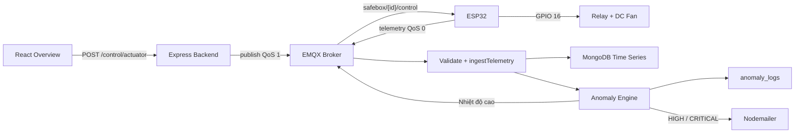

# Cẩm nang vấn đáp phần Thái Kiệt

Tài liệu này bám theo proposal của nhóm và phiên bản code hiện tại của SafeRoom IoT Box. Mục tiêu là giúp Thái Kiệt giải thích đúng phần mình phụ trách, chỉ được code liên quan, nói rõ giới hạn và đưa ra bằng chứng kiểm thử.

## 1. Phạm vi phụ trách

| ID | Chức năng | Điểm trong proposal | Phần cần nắm chắc |
|---|---|---:|---|
| CB-03 | Điều khiển quạt từ Website | 4.0 | React -> REST API -> MQTT QoS 1 -> ESP32 -> relay GPIO 16 |
| NC-01 | Phát hiện dữ liệu bất thường bằng Z-score | 2.0 | Rolling window N=30, Z-score, hard rules, dedupe, hành động tự động |
| NC-03 | Lưu dữ liệu cảm biến theo thời gian | 1.5 | MongoDB Time Series, schema, ingestion, retention 30 ngày, historical query |
| NC-05 | Cảnh báo tự động qua Email | 1.0 | Nodemailer, HIGH/CRITICAL, HTML template, throttle 15 phút |

Phần của Kiệt đi xuyên nhiều tầng. Không nên trả lời “em chỉ làm backend”. Câu trả lời chính xác hơn:

> Em phụ trách thiết kế và tích hợp bốn luồng CB-03, NC-01, NC-03 và NC-05. Trọng tâm code của em nằm ở backend, nhưng CB-03 còn có phần gọi API ở React và phần nhận lệnh MQTT trên ESP32. Em cũng viết test để chứng minh các tầng nối với nhau đúng contract.

## 2. Câu giới thiệu 30 giây

> Phần của em nhận telemetry từ ESP32 qua MQTT, kiểm tra và lưu vào MongoDB Time Series. Sau khi lưu, anomaly engine áp dụng hard rule cho gas và motion, còn nhiệt độ và độ ẩm có rolling Z-score N=30. Khi có anomaly HIGH hoặc CRITICAL, backend có thể bật quạt qua MQTT và gửi email, trong đó email được giới hạn một lần mỗi 15 phút theo từng cặp thiết bị và loại cảm biến. Với CB-03, người dùng bật quạt trên React, backend publish lệnh QoS 1, ESP32 nhận JSON và đổi GPIO 16.

## 3. Sơ đồ tổng thể phần Kiệt



Ba ý cần nhấn mạnh:

1. MQTT tách backend khỏi ESP32, vì vậy web không điều khiển GPIO trực tiếp.
2. Telemetry được validate trước khi lưu và trước khi chạy anomaly engine.
3. Gas vẫn có cảnh báo cục bộ trên ESP32; backend không được xem là lớp an toàn duy nhất.

## 4. CB-03 - Điều khiển quạt từ Website

### 4.1 Luồng xử lý

1. Người dùng nhấn nút fan trên `Overview.jsx`.
2. Frontend đảo trạng thái hiện tại và gửi `POST /api/v1/control/actuator`.
3. JWT được gắn vào request bởi `apiFetch()`.
4. Backend kiểm tra `deviceId`, actuator và state.
5. `mqttService.publishControlCommand()` publish JSON lên `safebox/{deviceId}/control`, QoS 1.
6. `MqttClient` trên ESP32 parse payload rồi gọi callback `onControlMessage()` trong `main.cpp`.
7. Callback định tuyến actuator `fan` sang module `Relay`; actuator lạ bị bỏ qua.
8. `Relay::on()` hoặc `Relay::off()` ghi GPIO 16 theo cấu hình `RELAY_ACTIVE_LOW`.
9. Backend tạm ghi trạng thái yêu cầu để UI phản hồi nhanh; telemetry kế tiếp từ ESP32 xác nhận lại trạng thái thật.

### 4.2 Contract quan trọng

Request từ frontend:

```json
{
  "deviceId": "safebox-01",
  "actuator": "fan",
  "state": true
}
```

MQTT command gửi xuống ESP32:

```json
{
  "actuator": "fan",
  "state": "on"
}
```

Topic:

```text
safebox/safebox-01/control
```

### 4.3 Vì sao REST dùng boolean nhưng MQTT dùng on/off?

- Boolean thuận tiện cho toggle React và validation API.
- Chuỗi `on`/`off` dễ đọc trên MQTT client và Serial Monitor.
- Backend là nơi chuyển đổi contract, nên ESP32 không phải hiểu nhiều định dạng.

### 4.4 Vì sao dùng QoS 1?

QoS 1 bảo đảm lệnh được giao ít nhất một lần giữa client và broker. Lệnh bật/tắt là idempotent: nhận `fan=on` hai lần vẫn chỉ cho fan ở trạng thái ON. Không được nói QoS 1 là “exactly once”; đó là QoS 2.

### 4.5 Requested state và confirmed state

Sau khi broker nhận publish thành công, backend cập nhật requested state để API status phản hồi ngay. Tuy nhiên đây chưa phải bằng chứng relay đã đổi trạng thái. Telemetry kế tiếp chứa `actuatorStates.fanOn` sẽ reconcile lại state theo báo cáo của ESP32.

Đây là câu trả lời tốt khi bị hỏi “publish thành công có chắc quạt quay chưa?”:

> Chưa chắc. Publish callback chỉ chứng minh broker nhận lệnh. Xác nhận thiết bị cần telemetry phản hồi hoặc acknowledgment riêng. Bản hiện tại dùng telemetry kế tiếp để reconcile; nếu cần xác nhận mạnh hơn có thể thêm command ID và ACK topic.

### 4.6 Fail-safe của firmware

- GPIO 16 được cấu hình OUTPUT khi khởi động.
- `Relay::begin()` gọi `off()` nên fan mặc định OFF; với HL-52S active-low, mức boot là HIGH.
- JSON sai bị bỏ qua; actuator lạ không có handler. Backend chỉ publish state hợp lệ `on`/`off`.
- Không có local auto-trigger cho fan ngoài yêu cầu backend, đúng phạm vi dự án.

## 5. NC-01 - Anomaly engine và Z-score

### 5.1 Công thức

```text
mean = tổng 30 giá trị / 30
variance = tổng (x_i - mean)^2 / 30
standard deviation = sqrt(variance)
Z = (giá trị mới - mean) / standard deviation
```

Một điểm được xem là anomaly thống kê khi đồng thời:

```text
|Z| > zScoreLimit
và
|giá trị mới - mean| > minimum physical delta
```

Giá trị mặc định:

| Thông số | Giá trị |
|---|---:|
| Window | 30 mẫu trước đó |
| Z-score limit | 3.0 |
| Minimum delta nhiệt độ | 1.0°C |
| Minimum delta độ ẩm | 2.0% |

### 5.2 Vì sao dùng 30 mẫu trước, không cho mẫu mới vào trước?

Mẫu mới phải được so với baseline trước đó. Nếu đưa spike vào window trước khi tính mean và độ lệch chuẩn, chính spike sẽ kéo baseline về phía nó và làm giảm Z-score. Code tính thống kê trước, sau đó mới `push` mẫu mới và bỏ mẫu cũ nhất.

### 5.3 Cold start và zero variance

- Ít hơn 30 mẫu: chưa đủ baseline, trả `ready=false` và dựa vào hard threshold.
- Độ lệch chuẩn bằng 0: không chia cho 0; trả Z=0 và không tạo anomaly thống kê.
- Hard threshold vẫn luôn hoạt động, kể cả khi Z-score chưa sẵn sàng.

### 5.4 Vì sao gas và motion không dùng Z-score?

- Nhiệt độ và độ ẩm là biến liên tục, phù hợp với phân tích độ lệch quanh baseline.
- Motion là boolean, không có ý nghĩa Gaussian.
- Gas là biến an toàn có ngưỡng cứng 600 PPM; chờ đủ 30 mẫu hoặc chờ Z-score có thể gây nguy hiểm.

### 5.5 Rule matrix thực tế

| Sensor | Điều kiện | Trigger | Severity | Hành động |
|---|---|---|---|---|
| Gas | `gasLevel > gasMax` | Hard threshold | CRITICAL | Log + email |
| Temperature | Ngoài min/max | Hard threshold | HIGH | Log + email; bật fan nếu vượt max |
| Temperature | Auto mode và Z bất thường | Z-score | HIGH | Log + email; bật fan nếu spike hướng lên |
| Motion | Motion=true và system armed | Hard threshold | HIGH | Log + email + alert LED |
| Humidity | Ngoài min/max | Hard threshold | MEDIUM | Log |
| Humidity | Auto mode và Z bất thường | Z-score | MEDIUM | Log |

### 5.6 Dedupe khác email throttle thế nào?

- Anomaly dedupe mặc định 60 giây, key gồm `deviceId:sensorType:triggerType`. Mục đích là tránh ghi cùng sự kiện quá dày.
- Email throttle là 15 phút, key gồm `deviceId:sensorType`. Mục đích là tránh spam hộp thư.
- Hai cơ chế giải quyết hai vấn đề khác nhau và không nên gộp.

### 5.7 Thứ tự xử lý anomaly có cố định không?

Không. Các candidate được xử lý bằng `Promise.all`, nên email hoặc MQTT của từng candidate có thể hoàn tất khác thứ tự. Điều cần bảo đảm là đủ tập anomaly và đúng nội dung, không dựa vào thứ tự hoàn thành.

## 6. NC-03 - MongoDB Time Series

### 6.1 Tại sao dùng Time Series collection?

Telemetry là dữ liệu liên tục, mỗi document có timestamp và deviceId. Time Series tối ưu cách MongoDB lưu và truy vấn dữ liệu theo thời gian, đồng thời hỗ trợ retention tự động.

### 6.2 Cấu hình authoritative

```text
collection: sensor_readings
timeField: timestamp
metaField: deviceId
granularity: seconds
expireAfterSeconds: 2,592,000 (30 ngày)
```

### 6.3 Luồng ghi dữ liệu

1. `mqttService` nhận topic telemetry.
2. `validateTelemetryPayload()` kiểm tra device ID, timestamp, metric và actuator state.
3. `SensorReading.create()` ghi document vào `sensor_readings`.
4. Document vừa ghi được chuyển cho anomaly engine.

Việc lưu trước rồi phân tích giúp giữ lại dữ liệu gốc ngay cả khi một hành động anomaly như email hoặc MQTT gặp lỗi.

### 6.4 Vì sao schema đặt `autoCreate=false`?

Mongoose không tự tạo collection thường. `timeSeriesService` chủ động tạo collection với đúng `timeseries` và TTL option trước khi model ghi dữ liệu. Nếu collection đã tồn tại nhưng sai cấu hình, backend fail fast và yêu cầu migration thay vì âm thầm chạy sai.

### 6.5 Historical query lấy dữ liệu thế nào?

Backend lọc theo device và khoảng thời gian, sort giảm dần để lấy đúng N mẫu mới nhất, áp dụng limit, sau đó reverse trong bộ nhớ để frontend nhận chuỗi theo thời gian tăng dần.

```text
MongoDB: newest -> oldest, limit N
Response: oldest -> newest trong N mẫu vừa chọn
```

Nếu sort tăng dần trước limit, API sẽ trả N mẫu cũ nhất trong khoảng, không phải N mẫu mới nhất.

### 6.6 TTL có xóa đúng ngay giây thứ 2,592,000 không?

Không nên khẳng định chính xác tới từng giây. MongoDB TTL monitor chạy nền, nên document được xóa sau khi hết hạn với một độ trễ nhỏ. Ý nghĩa là retention tự động, không phải timer realtime.

## 7. NC-05 - Email Notification

### 7.1 Luồng gửi email

1. Anomaly candidate được tạo.
2. `executeActions()` chỉ gọi email cho severity HIGH hoặc CRITICAL.
3. `sendAlertEmail()` đọc cấu hình SMTP sender từ environment.
4. Recipient resolver lấy `User.email` của các tài khoản có `settings.emailEnabled=true`.
5. Hàm tạo key `deviceId:sensorType` và kiểm tra lần gửi gần nhất.
6. Nếu chưa bị throttle, Nodemailer gửi cả text và HTML email.
7. Chỉ sau khi `sendMail()` thành công mới lưu thời điểm gửi.

### 7.2 Vì sao chỉ HIGH và CRITICAL?

MEDIUM như humidity bất thường vẫn được ghi log và hiển thị trên dashboard nhưng không gửi email để tránh cảnh báo quá mức. HIGH và CRITICAL cần người dùng phản ứng sớm hơn.

### 7.3 Vì sao throttle theo cặp device và sensor?

Gas trên `safebox-01` không được chặn email nhiệt độ trên cùng thiết bị, và cũng không được chặn gas trên `safebox-02`. Vì vậy key phải chứa cả device và sensor.

Ví dụ:

```text
safebox-01:gasLevel       -> một window riêng
safebox-01:temperature    -> một window riêng
safebox-02:gasLevel       -> một window riêng
```

### 7.4 Vì sao lưu throttle sau khi gửi thành công?

Nếu SMTP lỗi mà vẫn ghi thời điểm throttle, các lần retry tiếp theo sẽ bị chặn dù người dùng chưa nhận email nào. Code chỉ cập nhật map sau `sendMail()` thành công.

### 7.5 Giới hạn cần nói thật

- Throttle map nằm trong RAM, nên reset khi backend restart.
- Recipient lấy từ email đăng ký của mọi user đang bật email trong Settings; nếu tất cả user tắt thì SMTP không được gọi.
- Hệ thống chưa có quan hệ device-owner, nên mọi user đang bật đều nhận anomaly của thiết bị. Bản production cần ánh xạ user với device.
- `ALERT_RECIPIENT_EMAIL` chỉ là fallback khi database chưa có tài khoản nào.
- Nếu triển khai nhiều instance, nên chuyển throttle sang Redis/MongoDB.

## 8. Bản đồ file cần mở khi vấn đáp

| Phần | File chính | Vai trò |
|---|---|---|
| CB-03 frontend | `frontend/src/pages/Overview.jsx` | Toggle, POST API, optimistic state |
| CB-03 auth helper | `frontend/src/api.js` | Gắn JWT vào request |
| CB-03 API | `backend/routes/control.js` | Validate request và gọi MQTT service |
| CB-03 state | `backend/services/actuatorStateService.js` | Requested state và telemetry reconciliation |
| CB-03 MQTT | `backend/services/mqttService.js` | Publish QoS 1 và nhận telemetry/status |
| CB-03 firmware | `firmware/src/main.cpp` | Đăng ký callback và định tuyến actuator |
| CB-03 MQTT parser | `firmware/src/mqtt/mqtt_client.cpp` | Subscribe control topic và parse JSON |
| CB-03 relay | `firmware/src/actuators/relay.cpp` | Ghi GPIO 16 theo polarity cấu hình |
| NC-01 | `backend/services/anomalyEngine.js` | Z-score, rules, dedupe, actions |
| NC-01 schema | `backend/models/Schemas.js` | Cấu trúc `anomaly_logs` |
| NC-03 | `backend/services/timeSeriesService.js` | Tạo và verify Time Series collection |
| NC-03 ingestion | `backend/services/telemetryService.js` | Validate, create, gọi anomaly engine |
| NC-03 API | `backend/routes/telemetry.js` | Latest và historical query |
| NC-05 | `backend/services/emailService.js` | SMTP, template, severity, throttle |
| Khởi động | `backend/server.js` | MongoDB, Time Series, email, MQTT, mock |

Chi tiết code có trong [THAI_KIET_CODE_WALKTHROUGH.md](THAI_KIET_CODE_WALKTHROUGH.md).

## 9. Bằng chứng hiện có

Chạy tại thư mục `backend`:

```powershell
npm run test:kiet
```

Bộ test chứng minh:

- Mapping và reconcile actuator state.
- JWT chặn request không xác thực trong CB-03 simulation.
- N=30, per-device buffer, zero variance và minimum delta.
- Gas/motion không đi qua Z-score.
- Hard-rule matrix và hành động alert LED.
- Temperature spike tạo Z-score anomaly, bật fan, ghi log và gửi email.
- Email throttle cùng key và độc lập giữa các key.
- Time Series options và retention 30 ngày.
- Historical API chọn N mẫu mới nhất và trả theo thứ tự thời gian.

Điều chưa được test phần mềm thay thế hoàn toàn:

- Relay vật lý có click và fan quay dưới 500 ms hay không.
- SMTP thật có giao email trong dưới 5 giây hay không.
- EMQX và Atlas thật có ổn định trong phiên demo hay không.

Các mục này phải được đo bằng TC-02, TC-04, TC-05 và TC-06 với hạ tầng thật.

## 10. Cheat sheet một phút trước khi vào phòng

```text
CB-03:
React POST boolean -> backend validate -> MQTT on/off QoS 1
-> ESP32 MqttClient -> onControlMessage -> Relay -> GPIO 16
Publish success != physical ACK; telemetry kế tiếp reconcile state.

NC-01:
Z-score chỉ temp/humidity, previous N=30, |Z|>3 và min delta.
Gas >600 và motion dùng hard rule.
Cold start dùng hard bounds; sigma=0 thì Z=0.
Dedupe anomaly 60s khác email throttle 15m.

NC-03:
sensor_readings Time Series; timestamp=timeField; deviceId=metaField.
Granularity seconds; TTL 30 ngày.
Validate -> create -> anomaly engine.
Sort DESC + limit + reverse để lấy N mẫu mới nhất theo thứ tự tăng dần.

NC-05:
Nodemailer chỉ HIGH/CRITICAL.
Throttle key=deviceId:sensorType, 15 phút.
Chỉ ghi lastSent sau khi SMTP gửi thành công.
```
